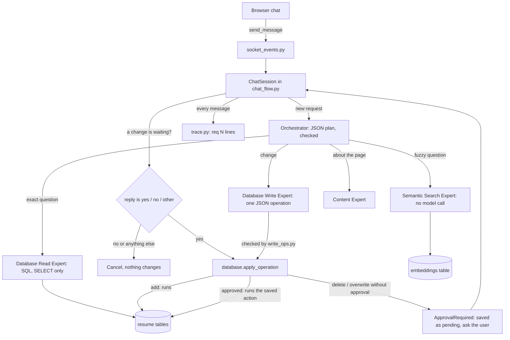

# Design and Testing Report — Homework 2

**Name:** Shahd Nabil Batrawi
**GitHub fork/branch URL:** https://github.com/shahdbatrawi/ai-agents/tree/HW2/Shahd
**Demo video link:** https://drive.google.com/file/d/1uI0xOrVjhyY0nPiiqe_94gsuoHQppiph/view?usp=sharing
**Command that runs my tests:** `python tests/run_scenarios.py` (from the `homework 2` folder)

## 0. Starting point

- **HW2:** My HW1 worked after the fixes I made before submitting it (the app starts, read questions answer, adding a skill works). The "Before You Start" checks found four things to fix first:
  - **Restart:** `createTables(purge=True)` wiped and reloaded the database at every start, so added skills disappeared. I changed startup so the CSVs load only once (see decision 1).
  - **`eval()` / `exec()`:** `eval()` ran the Orchestrator's plan and `exec()` ran the Write Expert's code, both in `llm.py`. Both are gone (see section 1).
  - **Embedding test:** I called the embedding model once and checked the vector length and that it was not all zeros before building on it.
  - **Model output in code fences:** the plan is now read as JSON and the fences are stripped before parsing.

## 1. How my system works



- **Orchestrator:** the model returns a JSON list of steps. My code checks every expert name, the message and the tables before anything runs (max 4 steps). Each step receives the earlier results, which is how two dependent steps work. If the search finds nothing, the remaining steps are skipped. *Changed from HW1:* the plan was run with `eval()`, now it is data.
- **Semantic Search Expert (new):** embeds the question and compares it with the stored vectors (cosine similarity in plain Python). Returns table, ID, text and score, best first, and drops results below `SEARCH_MIN_SCORE`. It makes no model call, so it cannot invent anything.
- **Database Read Expert:** unchanged idea (SQL for exact questions, SELECT only).
- **Database Write Expert:** *changed from HW1:* it no longer writes Python. It picks one operation from a fixed list (`add_skill`, `update_skill_level`, `delete_skill`, `delete_all_skills`) and fills in the values. Anything else is refused.
- **Approval:** the check is inside `database.apply_operation`, the only function that writes for the AI. A delete or overwrite raises `ApprovalRequired` unless it is given the same operation that the user approved. `ChatSession` keeps the pending operation, shows it, and on `yes` runs exactly that saved operation (the original message is never sent back to the model).
- **Trace:** every message prints `[req N]` lines: the request, the route and the reason, each step, the search scores, the operation, the approval state and the outcome.
- **Startup:** data loads once, prompts re-sync at every start, and missing embeddings are created (see decision 1).

## 2. Where to find things in my code

| What | File / function / table |
| --- | --- |
| Search by meaning (returns table, ID, text, score) | `flask_app/utils/semantic_search.py` → `search_by_meaning`; vectors in the `embeddings` table; embedding API call in `flask_app/utils/embeddings.py` |
| Trace output | `flask_app/utils/trace.py` (`new_request`, `log`); used in `chat_flow.py` and `llm.py` |
| Test command | `tests/run_scenarios.py`; test data in `fixtures/` (see section 7) |
| Settings (`.env.example`) | `.env.example` (key, `EMBEDDING_MODEL`, `SEARCH_MIN_SCORE`, optional `RESUME_DB_PATH`) |
| Approval check and allowed operations (HW2) | `flask_app/utils/database.py` → `apply_operation` and `ApprovalRequired`; allowed operations and their checks in `flask_app/utils/write_ops.py`; pending action and yes/no in `flask_app/utils/chat_flow.py` |

## 3. Three decisions I made

| Decision | Options I considered | What I chose | Why, and the trade-off | What would make me choose differently |
| --- | --- | --- | --- | --- |
| 1. How startup keeps data | (a) only change `purge=True` to `False`; (b) load the CSVs only if the tables are empty; (c) a `data_seeded` flag | (c): CSVs load once, `llm_roles` prompts are re-synced from the CSV at every start | (a) would not load prompt edits. (b) would reload deleted rows if the user emptied a table (for example S9 "clean up my skills", then restart). (c) fixes both. Cost: one extra table (`app_meta`). | If the course wanted a `reset` button, I would add a command that clears the flag. |
| 2. Search as a separate expert | (a) a separate Semantic Search Expert; (b) extend the Read Expert so the model writes SQL and calls search | (a), with no model call inside | The search cannot invent anything and the trace shows the real scores. Cost: the Orchestrator has to decide between exact and fuzzy, and the model sometimes adds an unnecessary second step. | If the Orchestrator chose wrongly too often, I would let the Read Expert try SQL first and fall back to search. |
| 3. What to embed and where to store it | Embed one column or several; vectors in SQLite or in a file | Several fields combined per table (name, department, city, state for institutions; title and responsibilities for positions; name and description for experiences; only the name for skills). Vectors stored as JSON text in SQLite with a `model` column | Combined text makes "MSU" match "Michigan State University - Computer Science, East Lansing". Storing the model name means vectors from another model are ignored, never mixed. Cost: JSON text is slower than a vector index, fine at this size. | With thousands of records I would use a vector index. |
| 4. The "no match" cut-off | A fixed number, a relative cut-off, or no cut-off | A fixed `SEARCH_MIN_SCORE=0.20`, chosen from real scores (printed with `tests/probe_scores.py`) | I first used 0.25 (measured on my own resume) and S2 failed on the course-style test data: Machine Learning scored 0.228. Harvard's best score is 0.183 on both the course data and my own resume (a skill called HTML), so it stays below 0.20. Cost: a thin margin (0.017 for Harvard, 0.028 for Machine Learning), and the value belongs to this embedding model. | A different embedding model means measuring again. |
| 5. Where the approval lives and how `yes` is matched | Check in the chat code; check in the write function; send the original request back to the model after `yes` | The check is in `database.apply_operation`. `yes` runs the saved operation only if it equals the one shown. Any reply other than `yes` / `no` (including `maybe` or a new question) cancels, and a pending action expires after 5 minutes | No code path can delete without approval (`U2` in the tests calls it directly). Cancelling on unclear replies is the safest rule. Cost: the user must repeat the request after a `maybe`. | If users often type `ok` or `sure`, I would add those words or ask again. |

## 4. Testing

All results come from the real models (`openai/gpt-4o-mini` for the chat and `nvidia/nemotron-3-embed-1b:free` for the embeddings) on the test database built from `fixtures/` (3 institutions, 4 positions, 6 experiences, 6 skills), in one run of `python tests/run_scenarios.py`: **13 passed, 0 failed** (U1 and U2 are two extra offline checks). Evidence: `evidence/run_scenarios_output.txt` (the full run) and one file per scenario in `evidence/` (for example `evidence/S10.txt`).

| Scenario / what I typed | What should happen | What actually happened | Pass / fail | Evidence |
| --- | --- | --- | --- | --- |
| **S1** `Find my MSU experience` | Michigan State University among the top results, scores in the trace | Route: Semantic Search Expert (the model also added a Read step, which listed CSE 477 and the other MSU experiences). `institutions#1 Michigan State University ... score 0.312`; the next result scored only 0.165 in a separate probe | Pass | `evidence/S1.txt` (route, reason, score line) |
| **S2** `What AI skills do I have?` | Machine Learning comes back, Public Speaking does not | Search over `skills` only: `Machine Learning score 0.228`. In the probe Public Speaking (0.159) and CSS (0.150) were below the cut-off, so only Machine Learning came back | Pass (after fixing the cut-off, see below) | `evidence/S2.txt` |
| **S4** `What did I do at MSU?` | Two steps: resolve the name, then look it up | Step 1 search `MSU` over `institutions` (0.310); step 2 SQL used `WHERE i.name = 'Michigan State University'`; the reply listed CSE 477, CSE 847, CSE 491 and Feature Imitating Networks | Pass | `evidence/S4.txt` (`step 1/2`, `step 2/2`) |
| **S5** add `Kubernetes`, restart | The skill and its embedding are still there and a search finds it | Added to CSE 477; after creating a new database object and calling `createTables` again it was still there with 0 new embeddings; search for "container orchestration" returned it first | Pass (in the test the restart is simulated; I also restarted the real app in the video) | `evidence/S5.txt` (`Embeddings up to date (0 new)`) |
| **S6/S7** `Remove the Public Speaking skill` then `no` / `yes` | Exact action shown; `no` changes nothing; `yes` runs only that | Reply: "This will delete 1 skill row(s) named 'Public Speaking'. Nothing has been changed yet." After `no` the skills were still `[CSS, HTML, Javascript, Machine Learning, Public Speaking, Python]`. After `yes`: `[CSS, HTML, Javascript, Machine Learning, Python]` | Pass | `evidence/S6.txt` and `evidence/S7.txt` (`approval: waiting` / `cancelled (no)` / `approved`, and the before/after lists) |
| **S8** request then `maybe`; request then a new question | Nothing runs, nothing is approved | Both were `cancelled (unclear)`; skills unchanged; a later `yes` went to the Orchestrator as a normal message, with no pending action to approve | Pass | `evidence/S8.txt` (`[req 11]`, `[req 13]`, `[req 14]`) |
| **S9** `Clean up my skills so the list is empty` | Paused although no danger word | The Write Expert chose `delete_all_skills`; reply: "This will delete ALL 6 skills (CSS, HTML, Javascript, Machine Learning, Public Speaking, Python)..."; `no` left them unchanged | Pass | `evidence/S9.txt` (`[req 15]`, `[req 16]`) |
| **S10** embedding model name made wrong (test only) | Clear error, no made-up match, app still works | The plan had two steps; step 1 gave `embedding failed: ... Model not-a-real-model/for-testing does not exist`, step 2 was skipped; reply "SEARCH FAILED: the search is unavailable right now"; no embedding stored; the next question (`How many skills do I have?` → 6) worked | Pass | `evidence/S10.txt` (`[req 17]`, `[req 18]`) |
| **S11** `Find my Harvard experience` | "Not found", nothing invented | `NO MATCH: nothing above the relevance cutoff`; the planned second step was skipped; reply "I could not find anything matching your request"; no row created | Pass | `evidence/S11.txt` (`[req 19]`) |

**What surprised me / what did not work at first**

- **S2 failed on my first run.** The trace showed `NO MATCH` for "AI skills" over `skills`. I had chosen the cut-off 0.25 using my own resume, where the skill is called "Artificial Intelligence Tools" (0.525). On the course data the skill is "Machine Learning", which shares no word with "AI" (0.228). I measured the scores for several wordings and for Harvard (`tests/probe_scores.py`), then set the cut-off to 0.20. It is a real limit (see section 5).
- **The model plans too much.** For "Find my MSU experience" (S1) the model added a second Read step, copying the two-step example in my prompt; the same happened for S10 and S11, where the search failed or found nothing and my code skipped the second step. It does not break anything but shows how strongly few-shot examples steer the model.
- **A summary mistake.** For S4 the final reply said the Researcher work on Feature Imitating Networks started "from January 1, 2019", which is the position's start date (the experience started on 2020-01-01). The SQL returned both dates; the model that writes the final reply picked the wrong one. Retrieval was right, the summary was imprecise.
- **A false positive I accepted on my own data.** "container tools" scores 0.428 against "Artificial Intelligence Tools" (shared word "tools") while Kubernetes scores only 0.286. No cut-off can remove the first without losing the second.
- **A problem found while reviewing my setup with the AI (not by a test):** my first `.env.example` had empty values such as `RESUME_DB_PATH=` and `SEARCH_MIN_SCORE=`. A grader who copies that file would get a nameless database path and no search cut-off. The code now treats an empty value as "not set", and `.env.example` ships the model name and `0.20` as defaults.
- **The test data was not the real sample at first.** The course `fixtures/` folder was not in the upstream repository, and my first test data was a copy that did not match the original sample resume. I rebuilt `fixtures/` from the original HW0 CSVs (see section 7) and ran everything again; all scenarios still pass, with different numbers (4 positions, 6 skills). The real data has two experiences with "AI" in them (CSE 491 and BRIDGE2AI), which is why a skills question searches only the `skills` table: otherwise they could push the skills out of the top results.
- To check that the tests are not always green, the AI assistant disabled the approval check in its own test copy: U2 and S6–S9 failed, as they should. I did not repeat this on my machine.

## 5. Limitations

1. **Limitation:** the cut-off is a fixed number that belongs to one embedding model and one dataset. **Impact:** S2 passes with a margin of only 0.028 (0.228 vs 0.20), Harvard's best score is only 0.017 below the cut-off (0.183), and the full sentence "What AI skills do I have?" scores 0.168 and would be cut if the Orchestrator passed it as it is (it normally shortens it to "AI skills"). **How I'd improve it:** combine the score with a keyword match, or re-rank the top results with the chat model, and measure the cut-off again whenever the model changes.
2. **Limitation:** a pending approval lives in memory, one per browser connection, and only the paused operation is kept. **Impact:** if the app restarts while a question is open, the pending action is gone (safe, but the user must ask again), and if a plan had more steps after the paused one, those steps are dropped. **How I'd improve it:** store pending actions in a table with the request ID and an expiry time, and resume the rest of the plan after `yes`.

## 6. My work and the help I used

**AI help.** I used Claude (an AI assistant) for most of HW2: it proposed the design and wrote the first version of the code, the tests and the draft of this report. I worked step by step: after each step I applied the files in my project, ran the app and the tests on my own machine with my own OpenRouter key, and sent the real terminal output back.

**What I did myself.**
- I set up the environment (`.env`, the free embedding model, my branch `HW2/Shahd`) and made local commits after each step.
- I applied each file, ran every command and tested the chat in the browser.
- I found and reported problems from my own runs: `insertRows` was missing from my `database.py` after I pasted it, the app was still calling `createTables(purge=True)`, `chat_flow.py` had not been replaced so the trace showed `[req -]` instead of request numbers, and the app listens on port 5000 although the provided `app.py` prints 8080.
- I ran the score probes (`tests/probe_scores.py`) on my own data and on the test data. They showed that the first cut-off (0.25) removed Machine Learning in S2, so we changed it to 0.20.
- I found that the course `fixtures/` folder was not published in the upstream repository, so I rebuilt it from the original HW0 sample CSVs with `git show` and added two skills (Machine Learning, Public Speaking), as the README describes, after being told it is the original sample resume. Then I re-ran the tests and regenerated the evidence.
- I reviewed and accepted the main design choices: the approval check inside `apply_operation`, cancelling on any reply other than `yes`/`no`, the `data_seeded` flag for startup, and JSON operations instead of `exec()`.

**What I can explain without the AI.**
- Why the approval check is inside `apply_operation` and not only in the chat code: any other code that writes would still be blocked, and a `yes` only runs the exact action that was shown.
- How search by meaning works and why I chose 0.20 as the cut-off: the question and the records become vectors, cosine similarity ranks them, and the cut-off comes from real scores (Machine Learning 0.228 passes, Public Speaking 0.159 and Harvard 0.149 do not).
- Why startup uses a `data_seeded` flag: the CSVs load once so deleted data stays deleted, while the prompts in `llm_roles.csv` re-sync at every start.

**Libraries and documentation:** Flask, Flask-SocketIO, SQLite, `requests`, `python-dotenv`, Jinja2; the OpenRouter chat and embeddings API; the HW2 README and rubric.

## 7. How to run it

```
pip install -r ../requirements.txt        # from the "homework 2" folder
cp .env.example .env                      # then fill OPENROUTER_API_KEY
python app.py                             # open http://localhost:5000
python tests/run_scenarios.py             # one command: S1-S11 with PASS / FAIL
```

- **Settings in `.env`:** `OPENROUTER_API_KEY`, `EMBEDDING_MODEL`, `SEARCH_MIN_SCORE`, and optionally `RESUME_DB_PATH`. (The app prints `localhost:8080` in the terminal because of a line in the provided `app.py`, but it listens on port 5000.)
- **Reset the test data only:** nothing to do. The test command deletes and rebuilds its own database (`tests/.test_resume.db`) from `fixtures/` (the original HW0 sample resume plus two extra skills, Machine Learning and Public Speaking; if that folder is missing it falls back to `tests/test_data/`), so your own `resume.db` is never touched. To reset the app's own data: stop the app, delete `flask_app/database/resume.db`, start it again.
- Scenarios marked `[API]` need a valid key; without one they are printed as SKIP.