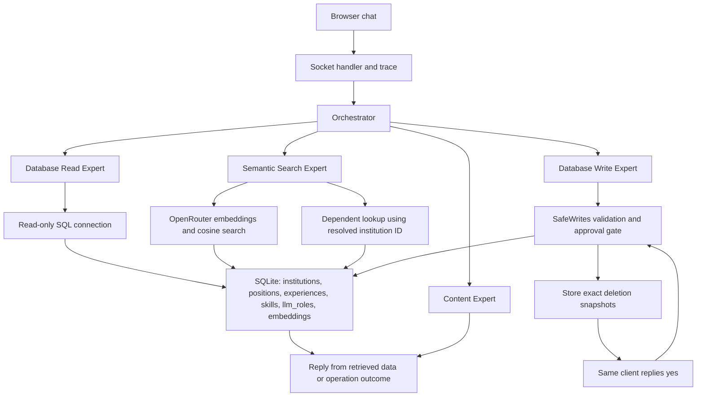

# Design and Testing Report — Homework 2

**Name:** Jamal Abdelnasser Hassan Abo Oun  
**GitHub fork/branch URL:** https://github.com/shahdbatrawi/ai-agents/tree/Jamal-HW2  
**Demo video link:** Pending recording  
**Command that runs my tests:** `python tests/run_scenarios.py`

## 0. Starting point

I extended my Homework 1 Flask, Flask-SocketIO, SQLite, and OpenRouter
application.

The original startup used `createTables(purge=True)`, which recreated
the resume data. I changed initialization so existing resume records are
preserved while LLM role configuration reloads on startup.

I replaced the model-generated Python plan and write-code execution with
validated JSON plans and a small set of allowed write operations.
Generated SELECT queries run through a read-only SQLite connection.

An initial real embedding request returned a valid, nonzero vector with
2048 dimensions. Separate startup tests confirmed that a deleted seed
skill stays deleted and prompt edits load after restart.

## 1. How my system works



The socket handler handles confirmation replies before sending new
requests to the Orchestrator. It assigns request IDs and prints traces.

The Orchestrator uses rules for common request patterns and a validated
model-generated plan for other requests. Exact questions use database
reads; fuzzy questions use semantic search.

Semantic search embeds the query and compares it with stored record
vectors. An institution request can first resolve an abbreviation, then
use the retrieved institution ID in a dependent SQL lookup.

SafeWrites validates allowed operations. Additions save the skill and
its embedding together. Deletions wait for approval and execute only the
stored record snapshots.

Compared with Homework 1, records persist, semantic retrieval is
available, and model output is no longer executed as Python code.

## 2. Where to find things in my code

| What | File / function / table |
|---|---|
| Semantic search with table, ID, text, score | `flask_app/utils/semantic_search.py`, `SemanticSearch.search` |
| Dependent institution lookup | `flask_app/utils/semantic_routes.py`, `run_semantic_request` |
| Routing and plan validation | `flask_app/utils/llm.py`, `choose_plan`, `validate_plan` |
| Trace output | `flask_app/utils/socket_events.py` and expert trace callbacks |
| Test command | `python tests/run_scenarios.py` |
| Settings | `.env.example` |
| Approval and allowed operations | `flask_app/utils/safe_writes.py`, `SafeWrites.submit`, `SafeWrites.answer` |
| Persistent vectors | SQLite `embeddings` table |
| Startup and role refresh | `flask_app/utils/database.py`, `createTables` |

## 3. Decisions I made

| Decision | Options I considered | What I chose | Why, and the trade-off | What would make me choose differently |
|---|---|---|---|---|
| Separate semantic retrieval | Extend the Read Expert or add a semantic component | A separate Semantic Search Expert | Keeps similarity search distinct from exact SQL, but adds routing logic | A smaller application with fewer request types |
| Embedded text | Names only or combined fields | Institution name, department, city, state, type; position title and responsibilities; experience name and description; skill name | Adds useful context while keeping skill searches focused; extra fields can also introduce noise | Broader evaluation showing another representation improves relevance |
| Search scope and cutoff | Search every table or restrict relevant tables; low or high cutoff | Skills questions search skills; institution questions search institutions; cutoff 0.17 | Rejects the observed Harvard and Public Speaking results while accepting MSU and Machine Learning; it is calibrated on a small dataset | A different embedding model, dataset, or more varied queries |
| Approval storage | Regenerate the action after yes or store the proposed action | Store exact skill snapshots per client and consume approval once | Prevents a second model call from changing the deletion, but pending state is held in memory | A deployment requiring multiple workers or durable sessions |
| Startup loading | Reload all CSV data or preserve resume rows separately from prompts | Seed new tables and refresh role configuration on startup | Preserves user changes while allowing prompt updates; resume CSV edits do not automatically update existing rows | A requirement for explicit data migrations or imports |

Embeddings are stored per source table, record ID, and model. Before
search, synchronization refreshes vectors when embedded text changes
and removes stale entries for missing records. Approved skill deletions
remove associated embeddings directly. Chat additions generate a valid
embedding before committing the skill and vector together.

The app does not currently offer a general chat edit operation.

## 4. Testing

All results below were observed on the development dataset. The original
sample resume was supplemented with Machine Learning and Public Speaking.
These results are not a claim of validation against official HW2 fixtures.

The single-command run reported **11/11 development scenarios PASS**.

| Scenario / what I typed | What should happen | What actually happened | Pass / fail | Evidence |
|---|---|---|---|---|
| S1: Find my MSU experience | Resolve Michigan State University with visible scores | MSU ranked first, score approximately 0.262702 | PASS | `semantic_search` trace and S1 summary |
| S2: What AI skills do I have? | Find an AI-related skill and reject unrelated skills | Machine Learning scored 0.210929; Public Speaking scored 0.128192 and was below 0.17 | PASS | Ranked skills trace and S2 summary |
| S3: List all my skills | Use Database Read Expert | Read-only SELECT returned six skills; no semantic search ran | PASS | Route reason, SQL trace, S3 summary |
| S4: What did I do at MSU? | Resolve the institution, then use its result | Institution ID 1 fed a dependent lookup returning four experience rows | PASS | `semantic_search` followed by `dependent_read` |
| S5: Add Rust programming to BRAINWORKS, level 7 | Preserve the skill and embedding after restart | A separate Python process found the saved skill and vector; Rust search scored approximately 0.730579 | PASS | Restart assertions and S5 summary |
| S6: Remove Python from CSE 847, then no | Show the exact action and preserve data | Cancellation left skills and other resume tables unchanged | PASS | Chat trace and database equality assertions |
| S7: Same request, then yes | Delete only the displayed skill | Only the target Python skill was removed; other resume records stayed unchanged | PASS | Approved trace and exact remaining-row assertions |
| S8: Deletion followed by maybe; separately a new subject | Cancel old approval | Later yes reported no pending action in both cases | PASS | Confirmation traces and unchanged-skill assertions |
| S9: Clean up my skills so the list is empty | Require approval despite indirect wording | All target skills were displayed; no cancelled the operation | PASS | Waiting/cancelled trace and database assertions |
| S10: Temporarily invalid embedding model | Report failure, save no invalid data, recover | HTTP 400 was reported; skills and embeddings stayed unchanged; listing still worked | PASS | API failure trace, snapshots, successful follow-up |
| S11: Find my Harvard experience | Return not found | Highest score was approximately 0.062833, below the cutoff | PASS | Rejected scores and exact not-found reply |

### Problems found during development

The chat model sometimes returned invalid JSON, unexpected fields, or
tool-call text. It also sometimes routed an MSU request to an exact SQL
query that returned no rows. I added structured output requirements,
strict validation, routing rules for common request patterns, and
deterministic formatting of retrieved results.

An addition initially shortened "Rust programming" to "Rust". The test
correctly failed its exact-name assertion. Explicit quoted-name requests
and instructions to preserve names fixed the observed case.

A Windows temporary-file cleanup error revealed an unclosed SQLite
connection in a test. Explicit connection closing fixed it.

The official `homework 2/fixtures/` directory was absent from the fetched
repository version inspected during development. Official-fixture
validation remains outstanding.

## 5. Limitations

1. **Limitation:** Routing rules cover common patterns, while other wording
   depends on the configured chat model.  
   **Impact:** Unseen wording can produce a rejected plan or unsuitable
   route.  
   **How I'd improve it:** Evaluate paraphrases and ambiguous requests,
   improve classification, and add bounded retries for invalid plans.

2. **Limitation:** The similarity cutoff was calibrated on a small
   development dataset.  
   **Impact:** Other queries or a different embedding model may produce
   false matches or miss relevant records.  
   **How I'd improve it:** Evaluate official fixtures and a larger labeled
   query set, then consider separate thresholds by table or query type.

## 6. My work and the help I used

I reused my Homework 1 application structure, resume interface, schema,
and Flask/Socket.IO setup.

I used substantial ChatGPT assistance to draft and revise Python code,
prompts, tests, and documentation. This included database persistence,
semantic retrieval, validated routing, approval handling, and the test
runner. I do not claim that all implementation code was written unaided.

I copied and integrated the changes locally, configured the environment,
ran the tests, inspected traces, and reported failures for correction.
The report describes the behavior observed in those runs.

Libraries used include Flask, Flask-SocketIO, requests, python-dotenv,
and Python standard-library SQLite, JSON, subprocess, and testing tools.
OpenRouter provides the chat and embedding APIs.

## 7. How to run it

From the repository root:

```bash
python -m venv .venv
```

Activate on Windows Git Bash:

```bash
source .venv/Scripts/activate
```

Install dependencies and enter the homework folder:

```bash
python -m pip install -r requirements.txt
cd "homework 2"
```

Create a private `.env` using `.env.example`. Required setting names:

- OPENROUTER_API_KEY
- OPENROUTER_CHAT_MODEL
- OPENROUTER_EMBEDDING_MODEL
- SEMANTIC_MIN_SCORE

Use the course-announced embedding model. The chat model must support
the structured output required by the app.

Run the application:

```bash
python app.py
```

Open http://localhost:8080.

Run the development scenarios:

```bash
python tests/run_scenarios.py
```

To reset only development test data, stop running tests and execute:

```bash
python -c "from pathlib import Path; Path('tests/calibration.db').unlink(missing_ok=True)"
python tests/run_scenarios.py
```

This recreates the calibration database and does not delete the
application's resume database. Write tests use temporary database copies.